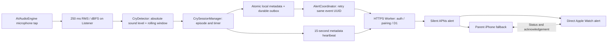

# Crib Service

Crib Service is a native iOS 17+ app that pairs two iPhones. Leave the **Listener** in the nursery; the **Parent** receives a silent push only after confirmed crying-like sound continues for a chosen duration. The default is five minutes, with a 20-second quiet reset. The app is implemented in Swift 6 / SwiftUI with a TypeScript Cloudflare Worker and D1. There are no iOS third-party dependencies, recordings, video, accounts, advertising, or analytics SDKs.

**Audio never leaves the Listener iPhone.** This is an energy detector, not a cry classifier: loud speech, music, appliances, or other sustained noise can trigger it. Quiet or distant crying can be missed.

## Safety

Crib Service detects sound only. It cannot detect breathing problems, movement problems, silent distress, medical emergencies, or unsafe sleep conditions. Do not rely on this app as a substitute for appropriate adult supervision or a medical monitoring device. Review this disclosure in onboarding before using either role.

## Architecture



- `ios/BabyCryMonitor/Audio` owns permission, audio sessions, microphone acquisition, route/interruption recovery, and RMS reduction. Buffers are consumed in the tap callback and never retained, recorded, or sent.
- `Models` and `Monitoring` are Foundation-only and also build as the `MonitorCore` Swift package. Detection, episode timing, the injectable clock, and delivery coordination can be tested without AVFoundation or a simulator. `CryDetecting` is the future on-device classifier seam; `AlertSending` is independent of UIKit; the Watch companion shares only Foundation message types.
- `Persistence` keeps metadata in an atomic JSON snapshot with file protection available after the first unlock. Device credentials are random 256-bit secrets in Keychain, scoped to role and backend, accessible after first unlock on this device only. A local write failure stops monitoring visibly.
- `AppModel` coordinates services and exposes their state to small SwiftUI views. It does not own RMS or cry classification logic.
- The Listener is the source of truth for episode starts, duration, and alert thresholds. The server only authenticates, stores metadata, deduplicates, and delivers. There is no server cry timer.

The checked-in `.xcodeproj`, shared scheme, assets, entitlements, privacy manifest, unit tests, and UI test are ready to open. `scripts/generate-project.py` reproduces the project without XcodeGen; rerun it after adding/removing source files. It overwrites generated project settings, so keep local signing/URL values in `ios/Config/Local.xcconfig`.

## Detection and timing decisions

The microphone is measured in approximately 250 ms windows. RMS uses all available input channels and becomes `20 * log10(max(rms, 0.00001))`, floored at -100 dBFS. Only this local scalar crosses the capture boundary.

Sound is loud when its microphone level reaches the selected absolute threshold, defaulting to -35 dBFS. Settings offers -60 through -10 dBFS in 5 dB steps: more negative values detect quieter sounds. The threshold stays fixed as room noise changes. dBFS measures the digital microphone signal, not calibrated room sound pressure. Sustained background noise above the selected level can trigger detection. Previously saved settings retain their -35 dBFS threshold; the retired sensitivity field is ignored.

The detector moves from quiet to possible cry after approximately two seconds of activity, allowing sub-second pauses. Confirmation requires at least 60% loud frames in a five-second rolling window and a currently loud frame. A cold start observes the full initial window; subsequent detection uses the existing five seconds of observations. Brief two-second noise does not qualify.

The alert clock begins **at confirmation**, rather than at the first loud sample. The initial window can add approximately five seconds to the physical onset-to-alert interval. Pauses shorter than the selected quiet reset preserve the episode and its original timer. Once quiet lasts 10/20/30/60 seconds, the episode ends at the beginning of that trailing silence. A due alert during a quiet gap waits for loud sound to resume; if the baby stays quiet, it sends no alert. This avoids an alert when the baby settles just before the threshold.

An initial event UUID and queue timestamp are saved atomically before any request. An episode creates exactly one initial event locally; optional repeat events have their own UUIDs and occur every two or five minutes from the previous queued event. Retries reuse the same UUID with exponential backoff (2 seconds to 5 minutes). Network failures do not reset cry timing. `alertSentAt` means APNs accepted the request, **not** that the Parent or Watch displayed it.

Heartbeats run independently of alert uploads. A suspended heartbeat cannot delay a ready alert, and a suspended alert upload cannot prevent fresh monitoring status. Monitoring starts and stops send an immediate heartbeat. Successful active heartbeats repeat every 15 seconds; failures retry after approximately 2, 4, 8, 16, then 30 seconds, with 10% jitter and a hard 30-second cap. Connectivity recovery allows an immediate retry. Failed stopped updates remain queued in memory for retry, including after a role change. Only one heartbeat request runs at a time, and new monitoring states replace obsolete queued updates for that Listener. Responses from before a stop/restart cannot mark the new monitoring session as freshly reported.

A terminal `failed` receipt moves the alert out of the retry queue into persistent local failure history without setting `alertSentAt`. The Listener episode panel explicitly shows terminal delivery failure instead of waiting for confirmation; diagnostics retain failure history, and other alerts can still be delivered. Older saved snapshots without failure history remain compatible.

An interruption or sample gap over two seconds ends the observed episode. The app cannot infer crying while the microphone is unavailable. A three-second capture watchdog visibly stops a stalled engine. Calls, route changes, and media-services resets attempt recovery when the audio session permits it. Relaunch ends any saved active episode at its last observed sample, preserves queued alerts/history, and requires monitoring to be restarted. It never assumes the microphone kept running after process termination.

The iPhone and Watch display name is **Crib Service**. The bundle identifiers are `com.jordanerenrich.cribservice` for iPhone and `com.jordanerenrich.cribservice.watchkitapp` for Watch; the test targets use the same iPhone prefix. Internal Xcode target names, Keychain service names, and backend resource names retain their original values.

The new iPhone and Watch App IDs were registered on 23 October 2026 under Apple Developer team `9PG633BF3R`, with Push Notifications enabled for both and Time Sensitive Notifications enabled for Watch. Critical Alerts requests were submitted for both new IDs: iPhone `73693T6553` and Watch `HK2ZB58GJZ`; both were shown as Submitted on 23 October 2026. Approval remains pending, so builds continue to use ordinary iPhone notifications and Time Sensitive Watch notifications. For a bundle-ID migration, ensure the APNs key covers both new topics before the coordinated rollout. Coordinate the Worker deployment (`APNS_BUNDLE_ID = com.jordanerenrich.cribservice`) with installation on both iPhones and Watch. These builds install as new apps, so existing app-container data and pairing do not automatically migrate; pair the new apps and enable notifications/direct Watch alerts again. The Critical Alerts requests above use the new identifiers. Earlier rollout notes below describe the previous bundle IDs and in-place installations.

## Xcode and iPhone setup

Requirements: current Xcode (verified with Xcode 27 / Swift 6.4), an iOS 17+ device, and an Apple Developer team with push notification entitlement for remote alerts. Two physical iPhones and a paired Apple Watch are required to verify the overnight acceptance scenario.

```sh
open ios/BabyCryMonitor.xcodeproj
# Only for a new checkout without Local.xcconfig; preserve the configured file here.
cp -n ios/Config/Local.xcconfig.example ios/Config/Local.xcconfig
```

1. The `BabyCryMonitor` target and Worker's `APNS_BUNDLE_ID` are configured as `com.jordanerenrich.cribservice`. The project generator also preserves this identifier and the matching test identifiers.
2. Apple team `9PG633BF3R` is set in the ignored `Local.xcconfig`. Sign in to that team's Apple account in Xcode and use automatic signing with the registered, push-enabled App ID/profile.
3. The project already includes **Push Notifications** and **Background Modes → Audio, AirPlay, and Picture in Picture**, with `UIBackgroundModes = audio`. Background remote-notification mode is unnecessary for visible alert pushes; there are no silent-background pushes.
4. The microphone usage explanation is already in `Info.plist`. The app asks on Start Monitoring, explains local processing, and shows a visible denial/error state. There are no ATS exceptions: the app only accepts HTTPS backend origins.
5. Set `BACKEND_URL` in ignored `Local.xcconfig`, using the provided `https:/$()/...` syntax to avoid xcconfig comment parsing. The connection is supplied by the build; there is no backend setup in app Settings. Both iPhones need builds configured for the same backend.
6. Debug builds use `aps-environment = development`; Release uses `production`. Match the Worker environment to the provisioning profile, rather than to whether the physical phone is used for development. TestFlight/App Store builds use production APNs.
7. Build and install on both iPhones. Use Listener on the nursery phone and Parent on the other.

If Xcode automatic signing is unavailable, the installed development certificate and the manual profiles **Crib Service Development** (J14/J17) and **Crib Service Watch Development** (Watch) can sign a Debug app build. Keep these local overrides in an ignored file; do not commit profiles or signing credentials:

```xcconfig
DEVELOPMENT_TEAM = 9PG633BF3R
BACKEND_URL = https:/$()/baby-cry-monitor.jordan-erenrich.workers.dev
PROVISIONING_PROFILE_SPECIFIER[sdk=iphoneos*] = Crib Service Development
PROVISIONING_PROFILE_SPECIFIER[sdk=watchos*] = Crib Service Watch Development
```

The cleanup retained the working overrides at `.local/cribservice-rollout-2026-10-23/Local.manual-signing.xcconfig` in the main checkout. Use them explicitly when needed, leaving normal automatic signing unchanged:

```sh
DEVELOPER_DIR=/Applications/Xcode.app/Contents/Developer xcodebuild \
  -project ios/BabyCryMonitor.xcodeproj -scheme BabyCryMonitor \
  -configuration Debug -destination 'generic/platform=iOS' \
  -xcconfig .local/cribservice-rollout-2026-10-23/Local.manual-signing.xcconfig \
  CODE_SIGN_STYLE=Manual build
```

These explicit profiles sign the iPhone and Watch apps; physical test runners need compatible profiles of their own. The temporary UI automation profile used during setup has been retired. Release/TestFlight needs production provisioning and a matching production APNs backend.

Start in the foreground, leave the Listener plugged in, and lock its screen. Monitoring continues while iOS keeps the valid recording audio session alive. There is no playback or audio streaming. Do not force quit the Listener. Recovery can require reopening the app if iOS does not allow reactivation in the background.

App icon rollout on 23 October 2026: the iPhone and Watch icons now use the original full-body bellhop beside a crib with a smiling baby standing inside. The source artwork and imagegen prompts are in `artwork/`; `swift scripts/draw-icon.swift` exports both opaque 1024×1024 asset-catalog icons. The signed combined iPhone/Watch build and signature verification passed, and the updated apps were installed in place and launched successfully on J14, J17 and Jordan’s Apple Watch. Existing app data and pairing were retained. Restart monitoring on the Listener after updating.

## Cloudflare deployment

Crib Service bundle-ID rollout on 23 October 2026: deployed source commit `7f975d5` as Worker version `c2a26aee-0460-437e-af32-bebd9b097d8f` to the existing `baby-cry-monitor` service. The live `APNS_BUNDLE_ID` is `com.jordanerenrich.cribservice`; the shared APNs sender uses that topic for iPhone and appends `.watchkitapp` for Watch, including cry/test pushes and connection notices. Live version inspection confirmed development APNs, the original D1 database, and all five secret bindings; the minute cron and disabled automatic observability were preserved. Backend resource names and URL remain unchanged.

Created Apple development profiles **Crib Service Development** (J14 and J17) and **Crib Service Watch Development** (the paired Watch) using the existing development certificate. Signed builds with the new identifiers were installed on both phones and the Watch; the iPhone build contains its Watch companion. New app identities require fresh onboarding, pairing and notification permission/direct Watch registration. Old app installations and data were retained. Critical Alerts approval is still pending; no critical entitlement was added.

Validation: 57 Foundation core tests, 107 iPhone unit tests, 50 Worker tests and TypeScript checks passed, as did the signed combined iPhone/Watch build. Live temporary-device smoke checks passed for fixed thresholds, applied settings, pairing, diagnostics, marked test events without tokens, and deletion/cleanup. Temporary devices were removed. Those automated smoke checks did not send hardware notifications. Physical notification validation was subsequently completed as recorded below; overnight monitoring remains a separate acceptance check.

Physical notification validation on 23 October 2026: J14 was confirmed as the actively monitoring Listener and J17 as its paired Parent. The Parent readiness screen reported paired iPhones and enabled iPhone notifications, and direct Watch push registration was active. A real test initiated on J14 was accepted by APNs at 19:10:26 UTC; the Watch recorded `watch_push_received` at 19:10:40 UTC. A second test was accepted at 19:32:32 UTC after the user put the Watch on their wrist and unlocked it; the user confirmed the notification test worked. This verifies real delivery for that test, not Critical Alerts authorization, a particular vibration strength, Sleep Focus behavior, or overnight reliability. Temporary UI automation helper apps were removed afterward.

Critical Alerts request records and selected redacted device-test evidence are retained locally under `.local/cribservice-rollout-2026-10-23/` in the main checkout. Keep the two app development profiles, the working signing certificate and APNs key, both registered app IDs, and the Critical Alerts requests (iPhone `73693T6553`, Watch `HK2ZB58GJZ`). Local build/test output can be regenerated; the working apps and backend do not depend on it.

The fixed sound threshold integration requires an updated Worker and matching app builds on both iPhones. Deploy the Worker before installing these builds: older Workers reject settings without sensitivity and thresholds other than −35 dBFS. Saved settings retain their −35 dBFS threshold; the retired sensitivity field is ignored when loading configurations and applied-settings acknowledgements. Older app versions still use adaptive detection and expect sensitivity in responses, so update both phones together. No database migration is needed for this integration. The bundle-ID rollout below deployed this integration together with the renamed app builds.

Readiness rollout on 23 October 2026: applied `0004_readiness.sql` to the existing remote database and deployed source revision `f489402` as Worker version `a9d78941-56ce-414c-bb26-5acd5308dc9a`. The existing database, secrets, minute cron and disabled automatic observability were preserved. Live checks passed for settings acknowledgement, connection-alert opt-in/out and role restrictions, clearly marked test events without tokens, authenticated unpairing, replacement pairing, history cleanup and device deletion. Temporary devices were deleted through the API; no push tokens were registered and no physical test notification was sent. Multiple successful maintenance records confirm the new version's cron is running. Signed Debug builds were installed in place and launched on J14, J17 and Jordan’s Apple Watch, preserving app data and pairing. Restart monitoring on the Listener and use Parent → Ready for tonight? to confirm actual notification presentation. The previous Worker version was `0e2a1f08-666e-4dd7-98f1-3bd5626e0ef6`.

Diagnostics rollout on 23 October 2026: applied `0003_diagnostics.sql` to the existing remote database and deployed source revision `be0b1dc` as Worker version `5cb305ca-f99f-4a13-9c5c-ea2c92e862b7`, preserving the minute cron and disabled automatic observability. Live temporary-device API checks passed, and a response confirmed `x-request-id` plus `x-diagnostics-status: recorded`; the temporary devices were removed without submitting push tokens or alert events. The signed Debug iPhone app and Watch companion were installed and launched successfully on J14, J17 and Jordan’s Apple Watch. Existing app data was preserved through in-place installation. Restart monitoring on the Listener after updating; this rollout did not run a physical test push.

The development backend is deployed at **[baby-cry-monitor.jordan-erenrich.workers.dev](https://baby-cry-monitor.jordan-erenrich.workers.dev)** (initial deployment 2 October 2026). Its D1 database is `baby-cry-monitor` (`60674623-4fae-4ee5-84d5-a80a88387662`) in Western Europe, bound as `DB`. The schema, independently generated encryption/pairing secrets, and minute Cron Trigger are configured. The local iOS `Local.xcconfig` points to this origin.

On 23 October 2026, version `943e489a-d5c1-4f1e-983d-270d27e066c4` was deployed with a 5-second minimum alert duration. A live temporary pair verified that a Parent can save 5 seconds, a Listener receives it on heartbeat, and Parent status returns the same setting; durations below 5 seconds are rejected. No push tokens or alert events were submitted by this check. The updated Debug app was signed, installed, and launched on J14 (iPhone 14 Pro) and J17 (iPhone 17 Pro). After updating, choose the desired duration, save settings, and restart monitoring on the Listener.

Later on 23 October 2026, version `ff235184-9a60-4d1e-9d21-df11976f264a` was deployed with support for clearly marked real test pushes. The corresponding signed Debug app was installed and launched on J14 and J17. On the paired Listener, use **Send test push** to exercise remote delivery to the Parent; the live temporary-pair check confirmed that test events are accepted and surfaced to the Parent with their test flag. No APNs token was submitted by that check, so real device presentation still needs to be checked on the receiving phone or Watch. The additive `0002_watch.sql` migration present in the shared workspace was also applied for compatibility with concurrent Watch backend changes included in that deployment.

Live checks passed for authentication rejection, device registration, single-use pairing, shared settings, heartbeat, and Parent status. The temporary test devices were removed afterward. The supplied APNs credentials (`APNS_KEY_ID`, `APNS_TEAM_ID`, and `APNS_PRIVATE_KEY`) are now stored as Cloudflare secrets; the key parsed successfully as an EC P-256 private key. Its contents were not copied into this repository. At that earlier deployment, the Worker targeted development APNs and bundle ID `com.jordanerenrich.babycrymonitor`; the current source uses `com.jordanerenrich.cribservice` and matching Debug provisioning. Real device delivery was subsequently verified on 23 October 2026 as recorded above. Use the physical acceptance checklist below for broader reliability testing. TestFlight/Release needs a separate production APNs backend.

The commands below are for reproducing the deployment. Do not create another database or regenerate existing encryption/pairing secrets when using the configured backend. All five secrets are already configured; proceed with physical device installation and testing.

The runtime Worker has no npm production dependencies. Wrangler, TypeScript, and Cloudflare's current Vitest plugin are development dependencies, locked in `worker/package-lock.json`. Use Node 22+ (verified with Node 24).

```sh
cd worker
npm ci
npm run typecheck
npm test
npx wrangler login
npx wrangler d1 create baby-cry-monitor
```

Copy the resulting database UUID into `worker/wrangler.toml`'s `database_id`. The binding name must remain `DB`. Set `APNS_BUNDLE_ID` and `APNS_ENVIRONMENT` (`development` or `production`) in `[vars]`. For both environments simultaneously, deploy separate Worker names with separate databases and secrets; point each app at the appropriate origin.

```sh
npm run db:remote
npx wrangler secret put APNS_KEY_ID
npx wrangler secret put APNS_TEAM_ID
npx wrangler secret put APNS_PRIVATE_KEY < /absolute/path/to/AuthKey_YOUR_KEY_ID.p8
openssl rand -base64 32 | npx wrangler secret put TOKEN_ENCRYPTION_KEY
openssl rand -base64 32 | npx wrangler secret put PAIRING_PEPPER
npm run deploy
```

The CLI prints the HTTPS Worker origin to set as `BACKEND_URL` before building for both phones. The configured minute Cron Trigger drains known failed/pending APNs dispatches and performs retention cleanup, even if the Listener stops. Enable that trigger when deploying. Never commit `.p8`, `.dev.vars`, real secrets, or local signing configuration. Avoid changing the encryption key without re-registering parent push tokens: existing encrypted tokens use the old key.

### APNs key setup

In the Apple Developer portal, create/download a token authentication key with Apple Push Notifications service access for the app. Record the key ID and your team ID. Upload the complete PKCS#8 `.p8` content as `APNS_PRIVATE_KEY`; literal escaped newlines and real newlines are supported. Match the bundle topic exactly. Parent Mode requests visual alerts/badges, registers its device token, and sends it over its authenticated HTTPS connection. D1 stores the token encrypted with AES-256-GCM and a unique IV, rather than plaintext.

The Worker creates an ES256 provider JWT, refreshes it within 50 minutes, and POSTs to Apple's sandbox or production APNs endpoint with alert push type. The payload deliberately omits `sound`, critical-alert keys, and time-sensitive interruption keys. Notification bodies show original duration/start time; the start in the push body is explicitly UTC, while the app formats it in the phone's local time.

D1's unique event primary key, unique initial-event index per episode, and atomic dispatch claim prevent duplicate requests or concurrent requests from sending another push. A changed payload cannot reuse an existing UUID. Acknowledgment is authorized to the paired Parent and acknowledges existing alerts for that episode; future enabled repeat events can still remind them.

**Delivery boundary:** APNs does not share a transaction with D1 or offer a displayed-on-Watch receipt. Explicit APNs rejection (e.g. 503/429) is safely retried. If a transport failure or Worker crash leaves acceptance ambiguous, the event becomes `uncertain` and is not automatically resent. Parent status and Listener delivery text expose that state. This chooses duplicate prevention over an ambiguous retry and cannot guarantee exactly-once physical notification delivery. Successful APNs acceptance also cannot guarantee prompt device presentation.

### Backend API

All authenticated calls use `Authorization: Bearer <device UUID>.<random secret>`. IDs are not secrets; secrets never appear in URLs. Registration is idempotent for the same ID/secret/role, and cannot overwrite an existing device credential. The client creates and saves the random credential before registration, so a lost registration response is recoverable.

| Endpoint | Role | Purpose |
| --- | --- | --- |
| `POST /v1/device/register` | New device | Register role and secret hash |
| `POST /v1/device/push-token` | Parent | Save encrypted APNs token; unblock pending events |
| `POST /v1/pairing/create` | Parent | Create hashed six-digit code, ten-minute expiry |
| `POST /v1/pairing/claim` | Listener | Consume code and associate one Listener with one Parent atomically |
| `POST /v1/listener/heartbeat` | Listener | Metadata/status; returns shared configuration |
| `POST /v1/listener/event` | Listener | Save/deduplicate and attempt APNs dispatch |
| `GET /v1/listener/status` | Paired device | Paired listener freshness, episodes, alerts, settings |
| `POST /v1/settings` | Paired device | Update shared configuration |
| `POST /v1/alert/acknowledge` | Parent | Acknowledge episode alerts |
| `POST /v1/test-push` | Parent | Request a marked real test through the paired Listener's alert path |
| `POST /v1/connection-alerts` | Parent | Opt in/out of Listener connection notices |
| `POST /v1/pairing/remove` | Paired device | Revoke pairing and clear shared server history |
| `POST /v1/device/delete` | Authenticated device | Clear shared server history and delete caller registration |

Code reuse by another device is rejected immediately. The original claimant can recover a lost response without making the code usable again. Device/IP registration and claim rate limits reduce guessing; Cloudflare sees the connection IP but only keyed hashes are persisted in rate-limit rows. The backend validates roles, UUIDs, settings, metadata, and event consistency. Heartbeat/event payloads reject additional fields such as audio, RMS, or sound features. Maximum request body size is 64 KiB.

Configuration changed on either phone is persisted locally and sent to the shared Parent configuration row. The Listener picks it up on its next heartbeat, usually within 15 seconds. Locally edited settings remain effective during disconnection and retry before a remote refresh can overwrite them. Last successful write wins if both phones edit settings concurrently.

## Local development and simulation

```sh
cd worker
cp .dev.vars.example .dev.vars
# Fill APNs values; generate distinct real random values for the two local secrets.
openssl rand -base64 32
openssl rand -base64 32
npm run db:local
npm run dev
```

The app enforces HTTPS, including for local development. Expose local Wrangler through a trusted HTTPS tunnel (for example, if `cloudflared` is already installed, run `cloudflared tunnel --url http://localhost:8787`) and set its HTTPS origin as `BACKEND_URL` before building both apps. Treat a temporary tunnel as development infrastructure. Tests need neither Cloudflare login nor APNs secrets: they create a temporary signing key, use real local D1 migrations, and replace only the external APNs fetch with deterministic responses.

On the **Listener**, tap **Send test push** in **Test notifications** (also available under Settings → Diagnostics & simulation → Real push test). This immediately queues a synthetic threshold event for the paired Parent through the real Worker/APNs delivery path, without microphone permission, starting monitoring, or waiting for the alert duration. The push is clearly titled **Test · Crib Service**; Parent Mode also labels it as a test. With direct Watch alerts registered it goes to the Watch with system sound/haptics (use Watch Silent Mode for vibration only); otherwise it uses the silent iPhone notification and normal system mirroring. Enable notifications on the receiving device first. APNs acceptance appears on the Listener but does not prove the phone or Watch displayed it.

Test pushes use the same persisted outbox, event UUID deduplication, and retry handling as real alerts. Offline tests remain queued until connectivity returns, including across relaunch. Each tap creates a separate test episode and leaves the live detector, crying timer, and episode history untouched. Real unacknowledged crying alerts take priority over tests in Parent Mode. The optional `isTest` metadata flag uses the existing JSON event storage. Deploy the updated Worker before installing this app version, and update both phones together as described in the fixed-threshold deployment note above.

In Settings → **Diagnostics & simulation**, inspect threshold/current dBFS, interruption status, device ID, backend, outbox size, and copy/share a bounded structured log. No raw audio or credentials are logged. The **Synthetic simulation · Local only** section feeds an isolated real state machine at 250 ms intervals with an injectable clock. It supports cry start, quiet, +30 seconds, +5 minutes, threshold trigger, and reset. Its separate preview button shows a clearly marked, silent **local** notification. These local simulation controls never upload events or change the live timer; use **Send test push** for an actual remote notification.

## Pairing and operation

1. Configure the same deployed backend on both iPhones.
2. On Parent, enable notifications; choose Pair Listener. A six-digit code appears and expires in ten minutes.
3. On Listener, choose Pair with Parent and enter that code. It becomes unusable by another device immediately.
4. Set the desired duration (5/30 sec or 1/2/3/5/10 min), quiet reset, absolute sound threshold (-60 to -10 dBFS, default -35 dBFS), and optional repeat alerts (default Off). Changes save automatically as soon as you select an option; tap **Done** to close Settings. Changes made on the Parent reach the Listener on its next update, normally within 15 seconds. Previously saved custom durations remain in effect until you choose a preset. More negative sound thresholds pick up quieter sounds. The selected level stays fixed as room noise changes. A 5-second alert delay begins after sound is confirmed, rather than after the first noise. The configured backend supports the 5-second minimum; other deployments must include the same validation update.
5. Start monitoring on Listener and grant microphone permission. Pairing is required to avoid an apparently active monitor with no alert recipient.
6. Keep it charging. Below 20% on battery, a visible warning appears; monitoring does not automatically stop.
7. Parent status refreshes approximately every 15 seconds while active. Listener heartbeats are approximately every 15 seconds. “Online” requires a fresh heartbeat reporting active monitoring, within 150 seconds. Stale/missing/error status becomes **unknown**, never a reassurance. Foreground network failure clears stale displayed status.
8. Temporary loss of internet does not stop local monitoring or its timer. Outbox events survive relaunch. Explicit microphone failure stops monitoring and requires visible recovery. After deploying migration `0004_readiness.sql` and the updated Worker, Parent Settings offers opt-in connection-loss and recovery notifications.

Only one Listener and one Parent are supported. Changing role creates/uses a separate credential for that role and backend; it does not unlink the previous pair. Use Settings → Unpair or replace a phone before pairing a replacement. This clears the old relationship and shared server history.

## Apple Watch app and vibration alerts

The **Crib Service** watchOS 10+ companion is embedded in the iPhone app. Select the `BabyCryWatch` scheme to run it directly, or install the updated iPhone app and use the iPhone Watch app to install its companion. The Watch shows nursery status, the alert threshold, incoming cry/test alerts, a vibration preview, and a 10-second local wrist test. **I'm checking** silences foreground reminders immediately and queues acknowledgement for the Parent iPhone; the Watch distinguishes queued acknowledgement from backend confirmation. The Parent retries acknowledgements after connection failures and app relaunch.

The nursery Listener still detects sustained sound locally. The Watch does not use its microphone. Watch Connectivity sends only status, alert metadata, APNs registration, and acknowledgement commands; device credentials and audio never cross to the Watch. Status refreshes while both apps are reachable. A cached Watch status becomes unknown after 45 seconds without a refreshed snapshot or 150 seconds without a Listener heartbeat.

### Initial setup

1. Apply `worker/migrations/0002_watch.sql` and deploy the updated Worker. These changes are required for direct Watch push registration; an old backend cannot register Watch alerts. Existing iPhone-only pushes continue to use their existing path.
2. In Apple Developer, enable Push Notifications and Time Sensitive Notifications for `com.jordanerenrich.cribservice.watchkitapp`. Use automatic signing with the same team as the iPhone app. The APNs key must be authorized for this Watch topic as well as the iPhone topic. Debug and Release use the existing development/production configuration.
3. On the paired iPhone, choose **Parent Alerts** and pair the nursery Listener. Open **Crib Service** on the Watch, then **Wrist alerts → Enable alerts** while the Parent app is open. Wait for **Direct Watch alerts registered**. The Watch APNs token is encrypted at rest by the Worker independently of the phone token.
4. On Watch, turn on **Silent Mode** and **Settings → Sounds & Haptics → Haptic Alerts → Prominent** for vibration without an audible notification. This is a user setting; the app cannot switch Silent Mode or change hardware haptic strength. Without Silent Mode the Watch notification can make a sound. The iPhone fallback notification still omits sound.
5. Allow this app in **Sleep Focus**, including **Time Sensitive Notifications**. Wear the Watch unlocked, charged, and connected through iPhone, Wi-Fi, or cellular. Time Sensitive alerts do not override user settings or provide Critical Alert privileges.

**Enable alerts** shows permission, Apple registration, and Parent iPhone sync progress beside the button. Registration waits for Watch Connectivity activation and retries when the iPhone becomes reachable. **Direct Watch alerts registered** confirms setup; **Retry setup** retries after a failure. If notifications were previously denied, enable them in the paired iPhone's **Watch → Notifications → Crib Service** settings and retry. Setup errors stay visible during nursery status refreshes. The enable button does not itself play a vibration; use **Feel alert pattern** or **Test in 10 seconds** to test the Watch.

### Delivery and limits

When a Watch token is registered, the Worker selects the Watch as the alert destination and sends a normal visible APNs alert under the Watch bundle topic, with system sound/haptics and a custom notification view. It does not also send a second notification to the iPhone. Without a registered Watch token it sends the existing silent iPhone notification, which Apple may mirror to a Watch according to system settings. Each event keeps its selected destination across retries. An explicit invalid-token rejection clears only the rejected token and allows a subsequent attempt at the available destination; transport uncertainty is never blindly replayed. `sent` means APNs accepted the request, not that the Watch vibrated or woke someone. A registered Watch going offline does not automatically escalate an already accepted alert to iPhone.

While the Watch app is active, a recent alert repeats three notification haptics spaced 1.5 seconds apart, followed by a 2.5-second pause before the next burst, for up to three minutes. **I'm checking** stops the reminders immediately; lowering the wrist or leaving the app also stops that loop. **Feel alert pattern** previews one matching three-tap burst. Older alerts remain visible with their sent time but do not restart vibrations. **watchOS does not permit unrestricted custom vibration loops while an ordinary app is asleep.** Background delivery uses system notifications and the Watch's Prominent Haptics setting; the app cannot increase hardware vibration strength. Optional Listener repeat alerts remain controlled by the existing two/five-minute repeat setting. The app cannot guarantee waking a sleeper.

### Physical acceptance check

- Wear the Watch with Silent Mode and Prominent Haptic Alerts enabled. Use **Feel alert pattern**, then **Test in 10 seconds** and lower the wrist. The preview plays the foreground three-tap burst; the delayed local test checks Watch system notification/haptic settings only, not remote delivery or detection.
- From the nursery Listener, send its real test push. With the Parent iPhone locked and Watch app closed, verify a clearly labelled test notification and wrist haptic. Repeat with Sleep Focus enabled and with the Watch on its intended overnight connection.
- Start nursery monitoring at a short threshold and play sustained sound near the Listener. Confirm a real alert after detection plus the configured delay; short noise must not alert. Test on actual hardware before overnight use.
- Open an alert: check foreground repeat vibrations and **I'm checking**. Verify Parent acknowledgement and that retries do not replay an acknowledged alert. Disconnect the iPhone, acknowledge on Watch, then reconnect and verify the queued acknowledgement completes.
- Stop the Listener or disconnect the Parent status sync. The Watch must show **Status unknown**, never stale reassurance.

Hardware vibration, Focus routing, background push receipt, and overnight wake effectiveness require physical testing; simulator builds cannot validate them.

Validation on 23 October 2026: unsigned watchOS device and combined iPhone/Watch device builds passed. After the delivery fixes, 30 Foundation core tests, 31 Worker tests, 53 iOS unit tests (including four Watch/iPhone integration tests), and the onboarding UI test passed. Coverage includes direct Watch routing, encrypted token registration/removal, invalid-token fallback, ambiguous-delivery duplicate prevention, suspended network requests, restart races, persistent failure history, and old snapshot compatibility. Hardware push delivery, background vibration, and overnight wake effectiveness remain unverified.

Build the companion with:

```sh
DEVELOPER_DIR=/Applications/Xcode.app/Contents/Developer xcodebuild \
  -project ios/BabyCryMonitor.xcodeproj -scheme BabyCryWatch \
  -destination 'generic/platform=watchOS' -derivedDataPath /tmp/BabyCryWatchBuild \
  CODE_SIGNING_ALLOWED=NO build
```

Use `DEVELOPER_DIR=/Applications/Xcode.app/Contents/Developer` for `swift test` as well if the system default points to Command Line Tools without XCTest.

## Tests and validation commands

From repository root:

```sh
# Foundation-only deterministic core, including offline transport/outbox recovery
swift test

# Unsigned app compile (provisioning is required to install on a real device)
xcodebuild -project ios/BabyCryMonitor.xcodeproj -scheme BabyCryMonitor \
  -destination 'generic/platform=iOS' -derivedDataPath /tmp/BabyCryBuild \
  CODE_SIGNING_ALLOWED=NO build

# Unit tests and onboarding/role/UI integration on your installed simulator
xcrun simctl list devices available
xcodebuild -project ios/BabyCryMonitor.xcodeproj -scheme BabyCryMonitor \
  -destination 'platform=iOS Simulator,name=iPhone 18 Pro' \
  -derivedDataPath /tmp/BabyCryTests test

# Worker: real local D1, mocked APNs boundary
cd worker
npm ci
npm run typecheck
npm test
npm audit
npx wrangler deploy --dry-run --outdir /tmp/BabyCryWorkerBuild
```

Use a simulator name installed on your machine. Keep default ad hoc simulator signing enabled when running tests: Keychain access fails on an unsigned installed app. `CODE_SIGNING_ALLOWED=NO` above is only for compiling the physical-device target without provisioning. In a restricted execution environment, SwiftPM may need `--disable-sandbox` and `CLANG_MODULE_CACHE_PATH` / `SWIFTPM_MODULECACHE_OVERRIDE` set to writable temporary paths. Xcode macro plugins and simulator services also need permission to run outside a nested sandbox. Normal Terminal/Xcode usage needs no workaround.

iOS tests also verify real file outbox persistence, corruption reporting, and exclusion from backup. The Data Protection attribute assertion runs only on physical iOS: simulator files use the macOS filesystem.

Unit tests cover brief noise, shorter episodes, confirmation-based timing, exactly one initial alert, short/long pauses, quiet-reset boundaries, settling near the threshold, gaps across threshold, repeat/reset, absolute-level boundaries and independence from previous room noise, legacy settings restoration, invalid samples/configuration, bounded history, microphone observation gaps, and restored offline retries using stable UUIDs. Worker tests cover auth, role isolation, idempotent registration, expiring/single-use pairing, guessing limits, encrypted tokens, server freshness, shared settings, rejected audio fields, authorized status/acknowledgment, silent ES256 APNs requests, duplicate/concurrent event claims, explicit-error retries, missing-token recovery, and ambiguous dispatch.

### Physical acceptance checklist (still required)

- Pair two phones; set 5 minutes, 20-second reset, -35 dBFS sound threshold, repeats Off.
- Lock Listener; play crying-like sound for two minutes, then silence: no alert.
- Play continuous sound for over five minutes after confirmation: one initial notification.
- Repeat with 5–10 second gaps: preserve timer. With over 20 seconds quiet: end/reset.
- Lose network across the threshold, reconnect: same stored event retries without resetting the timer.
- Receive a call, change audio routes, disconnect Bluetooth, lock/background, and return to foreground: active capture resumes if permitted, otherwise a visible restart state appears. No unobserved interval is counted.
- Stop/force quit Listener: Parent loses fresh active status within the heartbeat freshness window.
- Lock Parent while wearing Watch: verify mirrored haptic notification without a deliberately configured sound.
- Disconnect power below 20%: warning appears, monitoring continues.

## Privacy and retention

Logging coverage, privacy guarantees, deployment steps and incident queries are documented in [the diagnostics review and runbook](docs/diagnostics-review.md). Server diagnostics use a restricted D1 journal (seven-day scheduled retention, capped at 10,000 entries); automatic Worker request logging remains disabled. API request references connect opt-in app exports to server records without adding device identities or payloads to diagnostic rows. Apply migration `0003_diagnostics.sql` before deploying these Worker changes.

Microphone buffers exist only transiently in AVFoundation. dBFS and local episode maximum/average levels remain local. HTTPS sends device authentication, push token, pairing code, configuration, timestamps, episode start/end/alert metadata, state, power/battery metadata, and alert events. No audio or acoustic feature vectors are serialized. Device metadata and episodes are sensitive; the Worker/database operator can access them.

Local history holds the last 100 completed episodes and the last 100 failed alert deliveries; diagnostics hold the last 500 lines. D1 receives at most 100 episode metadata records in the latest heartbeat. Events/deduplication records retain 30 days; events older than 24 hours do not produce a new delayed push. Existing blocked/pending/uncertain events remain visible in status. Settings supports authenticated unpairing and device deletion: both delete shared server history, pairing codes, heartbeats, connection states and queued notices, and clear this iPhone's local episode/outbox history. Device deletion also removes the caller's registration and rotates its local credential. The counterpart's registration and local files remain; restricted diagnostic records follow their separate retention. Notifications already accepted by Apple cannot be recalled. Connection notices expire from D1 after seven days. The local outbox retains alerts until APNs acceptance, acknowledgement, or a terminal failure. Terminal failures move to local failure history and are not retried. Blocked and uncertain entries require deployment/token repair or manual review and are never shown as successful.

The privacy manifest declares app-functional device identifiers and other metadata, plus the UserDefaults required-reason API. Verify App Store privacy labels and your privacy policy for the actual deployment/retention before distribution.

## Readiness, connection alerts and room checks

These additions are deployed to the configured backend and installed on J14, J17 and the paired Watch as recorded above. For another environment or future recreation, apply migration `0004_readiness.sql` **before** deploying the updated Worker, followed by an updated iPhone build. Run `npm run db:remote` and `npm run deploy` from `worker`; preserve the configured database, encryption secrets and minute cron. `scripts/cloudflare-smoke.mjs` verifies the new APIs with temporary devices and deletes them without registering push tokens or sending a notification.

- **Ready for tonight?** on Parent shows pairing, a recent active Listener heartbeat, power, iPhone notification registration/permission, applied settings and a test acknowledged within 30 minutes. The Parent can request a clearly marked real notification, then confirm receipt. This checks backend-to-receiver delivery; also send a test from the Listener to check its own upload path. Test with the intended locked-screen, Sleep Focus and Watch conditions.
- **Connection-loss alerts** are disabled by default and enabled in Parent Settings. A server minute check reports an active Listener missing updates for over three minutes (normally within four minutes), a stopped Listener, and a return to active monitoring. One transition creates one durable notice. Known APNs rejections retry with bounded backoff; ambiguous acceptance is never replayed. Outdated notices are cancelled and pending notices expire after ten minutes; APNs holds a notice for at most three minutes after submission. A notice can still arrive after the situation changes. These notices require the Worker/cron and receiving internet connection to work; they do not detect an outage of the backend itself.
- **Settings status** distinguishes local saving, waiting for Listener confirmation and applied settings. Heartbeats report the actual applied configuration; receiving a changed configuration causes a follow-up heartbeat. Older Listener builds do not report this acknowledgement and remain “Waiting for Listener confirmation.”
- **Parent status** distinguishes Not paired, Status unavailable, Connection lost, Stopped and Monitoring. Battery/charging values show their last-update limitation when status is stale.
- **Check room sound** on Listener measures ten seconds of background and eight seconds of sample sound while monitoring remains stopped. Local-only bounded scalar samples suggest the highest selectable fixed threshold at least 8 dB above the measured background and at least 2 dB below the typical sample. The recommendation uses the same −60 to −10 dBFS choices as Settings, including levels below the previous −35 dBFS floor. If no selectable level has enough separation, reposition the phone or reduce room noise and repeat. Applying a recommendation saves the fixed level; it does not adapt afterward. No audio, sound levels or calibration results are uploaded. This helps with placement and threshold selection; it cannot establish cry-classification accuracy. Re-run after moving the phone or changing normal room noise.
- **Unpair or replace a phone** clears the old relationship and shared history before creating a new pairing code. The Listener checks for revoked/replaced pairing while active and stops/clears its episode history when it observes that change. A disconnected counterpart cannot be wiped remotely. Old episode metadata and alert events predating a replacement pairing are rejected/filtered by the server.

Use [the hardware validation matrix](docs/readiness-validation.md) for release checks and record actual device results; local automated tests cannot complete an overnight check.

## Known limits and next improvements

The readiness features are deployed to the existing Cloudflare backend with live API checks, and signed Debug builds are installed on J14, J17 and the paired Watch. **Real-device push presentation and overnight validation remain unfinished.** Restart the Listener and run the phone/Watch checks below with the intended room, charging, network and Focus conditions. Simulator tests do not prove background audio behavior on physical hardware. Notification delays or suppression remain possible; killed apps cannot continuously listen. Opt-in server connection alerts depend on working cron/APNs and receiver connectivity. There are no remote audio, video, or breathing/movement checks.

Next three highest-value improvements:

1. Run the physical overnight/interruption/Watch matrix and tune sound detection with several real rooms and phones, including fan/white-noise conditions.
2. Evaluate an explicit delivery-uncertainty review/retry workflow without automatically replaying notifications that may already have arrived.
3. Evaluate an on-device cry classifier behind `CryDetecting` to reduce non-cry noise alerts, using labelled sound data and measured false-positive/false-negative rates.

## Primary documentation

- [Apple: sending notification requests to APNs](https://developer.apple.com/documentation/usernotifications/sending-notification-requests-to-apns)
- [Apple: handling audio interruptions](https://developer.apple.com/documentation/avfaudio/handling-audio-interruptions)
- [Cloudflare: D1 queries](https://developers.cloudflare.com/d1/best-practices/query-d1/)
- [Cloudflare: Workers Vitest integration](https://developers.cloudflare.com/workers/testing/vitest-integration/)

### Exception diagnostics

The on-device diagnostic export includes redacted exception details for storage, audio, network,
pairing, credentials, notifications, and Watch sync failures. Entries identify known error domains,
numeric codes, common file-error categories, and up to three underlying causes. JSON decoding and
encoding errors include a bounded path made from known schema field names and array indices; unknown
keys are redacted. Raw exception descriptions, payload values, file paths, URLs, tokens, pairing codes,
and server response bodies are excluded. Repeated failures are sampled by their exception details so
a changed cause remains visible. These details apply to new failures after installing this build;
previous entries cannot be reconstructed.

Metadata failures include the operation (`metadata_directory`, `metadata_read`, `metadata_decode`,
`metadata_encode`, `metadata_write`, or `metadata_backup_exclusion`). A later blocked Start attempt
logs the retained exception again as `monitoring_start_blocked_storage`. Safety acceptance has its
own message and diagnostic event. `persistence=available` describes the diagnostic log file only;
a failure to save that log adds `diagnostic_storage_error` to the in-memory export. Local monitoring
data is never deleted or reset as part of logging.
